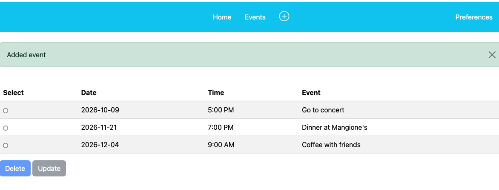
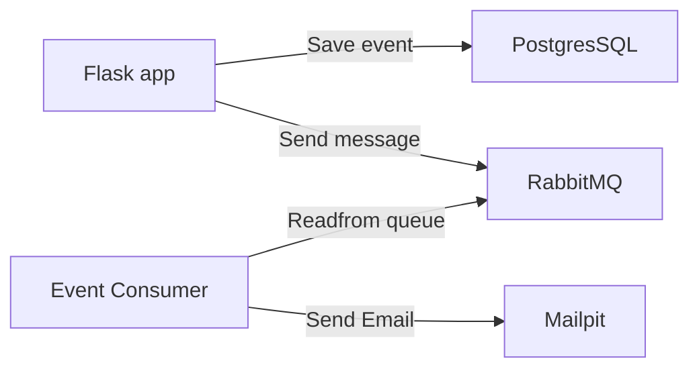
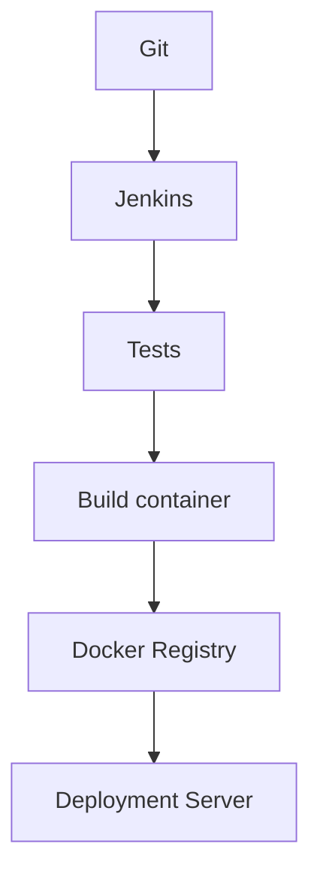

# Deployed!

## Intro

This is a fun project where:

- Servers are provisioned
- Code/Tests get written
- Scripts automate repetitive tasks
- Pipelines deploy services

## Why I wrote this

This project involves many languages, tools and platforms as you can see from the folder layout. What you can't see is the motivation behind everything. Why I bothered provisioning servers on my Linux box. Why I spent so much time with docker compose instead of jumping into Kubernetes. Why I didn't just use an AI prompt to write all the code for my microservices.

The primary motivation is that I like learning. I also like to improve processes. Even if some tools are downright frustrating to use, they're still indispensible for many people, including me! For example, I spent weeks developing an optimal Jenkins pipeline script. At that time, I was still using docker compose because I think docker compose is still useful for container orchestration. I ended up finding a no-code method that easily switches between local and cloud deployments. 

## Highlights of the project

- Developed a web app for an events calendar using Python. 🗓️
- Tracked tasks including backlog using Kanban. 📋
- Wrote unit/integration tests to validate code before committing to git. ✅
- Wrote Ansible scripts to provision VMs and servers. ⚙️
- Wrote Jenkins pipeline scripts to poll github for changes and deploy microservices. 🚀
- Troubleshooted and fixed faulty deployments due to networking and configuration issues. 🔧

## Some things I'm proud of

- Wrote microservices using Python and Go, two of my favorite languages, and in the process learned the importance of decoupled services. 🪐
- Completely removed sensitive information including credentials and IPs from Jenkins pipeline scripts. 🔐
- Deployed the microservices to the cloud ☁️ in only 2 days. 🎉

## What the app looks like

Below is a screenshot of the app. It's basically an events calandar, the kind that you'll find on community websites. 

## What the app looks like from the inside

The main app is written in Python and uses the Flask web framework. When a user creates a new event, a message is sent to a queue. This is consumed by the Event Consumer, which uses the message to send an email message to Mailpit. The asynchronous communcation between the Flask app and the Event Consumer means if one service goes down, it doesn't affect the other.

## How the app is deployed

The Jenkins pipeline takes care of polling git for changes, running tests and deploying images/containers.

