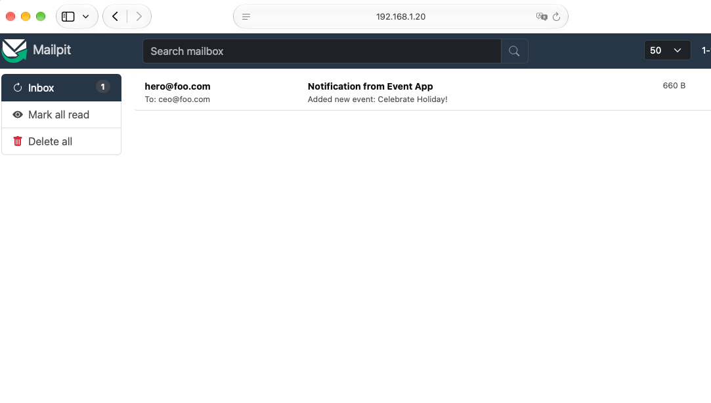

# Introduction

The *event-consumer* receives messages from on or more queues.

The *event-producer* is a test server that genrates messages and puts them into the queues.

## Usage

To build both projects, run:

```sh
make
```

The docker compose file is an easy way to run the event-consumer and event-producer. Below is a screenshot from Mailpit:




Below is output that shows messages that were sent and received.

```sh
eventconsumer-1  | 2026/10/29 00:52:55 No preferences file found, using defaults
eventconsumer-1  | 2026/10/29 00:52:55 NotificationDelay: 0
eventconsumer-1  | 2026/10/29 00:52:55 From: 
eventconsumer-1  | 2026/10/29 00:52:55 To: 
rabbitmq-1       | 2026-10-29 00:52:55.912404+00:00 [info] <0.1067.0> accepting AMQP connection 172.22.0.4:35866 -> 172.22.0.3:5672
rabbitmq-1       | 2026-10-29 00:52:55.913057+00:00 [info] <0.1067.0> User 'user' authenticated successfully
rabbitmq-1       | 2026-10-29 00:52:55.913350+00:00 [info] <0.1067.0> connection 172.22.0.4:35866 -> 172.22.0.3:5672: user 'user' authenticated and granted access to vhost 'rabbitmq'
rabbitmq-1       | 2026-10-29 00:52:55.915555+00:00 [info] <0.1076.0> queue 'event_confirmation' in vhost 'rabbitmq': delivery_limit not set, defaulting to 20
rabbitmq-1       | 2026-10-29 00:52:55.921057+00:00 [notice] <0.1081.0> queue 'event_confirmation' in vhost 'rabbitmq': candidate -> leader in term: 1 machine version: 8, last applied 0
rabbitmq-1       | 2026-10-29 00:52:55.921199+00:00 [info] <0.1076.0> ra: started cluster rabbitmq_event_confirmation with 1 servers. 0 servers failed to start: []. Leader: {rabbitmq_event_confirmation,rabbit@8d32b2a033dc}
rabbitmq-1       | 2026-10-29 00:52:55.921262+00:00 [info] <0.1076.0> queue 'event_confirmation' in vhost 'rabbitmq': delivery_limit not set, defaulting to 20
rabbitmq-1       | 2026-10-29 00:52:55.924161+00:00 [info] <0.1076.0> queue 'confirmation_prefs' in vhost 'rabbitmq': delivery_limit not set, defaulting to 20
rabbitmq-1       | 2026-10-29 00:52:55.928816+00:00 [notice] <0.1090.0> queue 'confirmation_prefs' in vhost 'rabbitmq': candidate -> leader in term: 1 machine version: 8, last applied 0
rabbitmq-1       | 2026-10-29 00:52:55.928965+00:00 [info] <0.1076.0> ra: started cluster rabbitmq_confirmation_prefs with 1 servers. 0 servers failed to start: []. Leader: {rabbitmq_confirmation_prefs,rabbit@8d32b2a033dc}
rabbitmq-1       | 2026-10-29 00:52:55.929013+00:00 [info] <0.1076.0> queue 'confirmation_prefs' in vhost 'rabbitmq': delivery_limit not set, defaulting to 20
eventconsumer-1  | 2026/10/29 00:52:55  [*] Waiting for messages. To exit press CTRL+C
rabbitmq-1       | 2026-10-29 00:52:56.016518+00:00 [info] <0.1099.0> accepting AMQP connection 172.22.0.5:39372 -> 172.22.0.3:5672
rabbitmq-1       | 2026-10-29 00:52:56.017284+00:00 [info] <0.1099.0> User 'user' authenticated successfully
rabbitmq-1       | 2026-10-29 00:52:56.017570+00:00 [info] <0.1099.0> connection 172.22.0.5:39372 -> 172.22.0.3:5672: user 'user' authenticated and granted access to vhost 'rabbitmq'
eventproducer-1  | 2026/10/29 00:52:56  [x] Sent Added new event: Celebrate Birthday!
eventconsumer-1  | 2026/10/29 00:52:56 Received a confirmation message: (Added new event: Celebrate Birthday!)
eventconsumer-1  | 2026/10/29 00:52:56 Sleeping for 0 seconds
eventconsumer-1  | 2026/10/29 00:52:56 Sending notification with subject: (Added new event: Celebrate Birthday!) from:  to: 
eventconsumer-1  | 2026/10/29 00:52:56 Failed to set from address
eventconsumer-1  | Will not send notification due to error: failed to parse mail address "": mail: no address 
eventproducer-1  | 2026/10/29 00:53:01  [x] Sent from: hero@foo.com
eventproducer-1  | to: ceo@foo.com
eventproducer-1  | notificationDelay: "3"
eventproducer-1  | 
eventconsumer-1  | 2026/10/29 00:53:01 Received prefs message: (from: hero@foo.com
eventconsumer-1  | to: ceo@foo.com
eventconsumer-1  | notificationDelay: "3"
eventconsumer-1  | )
eventproducer-1  | 2026/10/29 00:53:06  [x] Sent Added new event: Celebrate Holiday!
rabbitmq-1       | 2026-10-29 00:53:06.021967+00:00 [info] <0.1099.0> closing AMQP connection (172.22.0.5:39372 -> 172.22.0.3:5672, vhost: 'rabbitmq', user: 'user', duration: '10s')
eventconsumer-1  | 2026/10/29 00:53:06 Received a confirmation message: (Added new event: Celebrate Holiday!)
eventconsumer-1  | 2026/10/29 00:53:06 Sleeping for 3 seconds
eventproducer-1 exited with code 0
eventconsumer-1  | 2026/10/29 00:53:09 Sending notification with subject: (Added new event: Celebrate Holiday!) from: hero@foo.com to: ceo@foo.com
eventconsumer-1  | 2026/10/29 00:53:09 SMTP send succeeded
```

