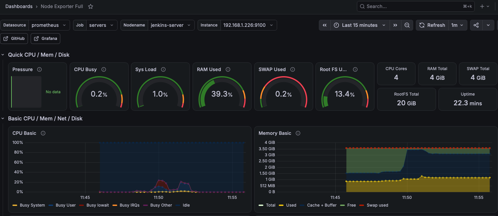
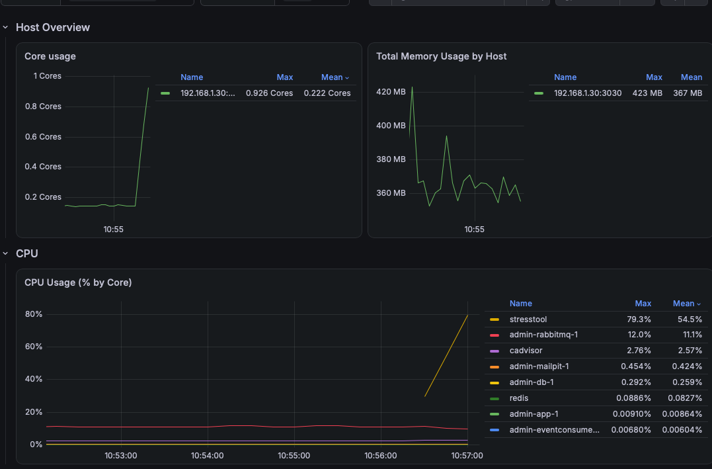
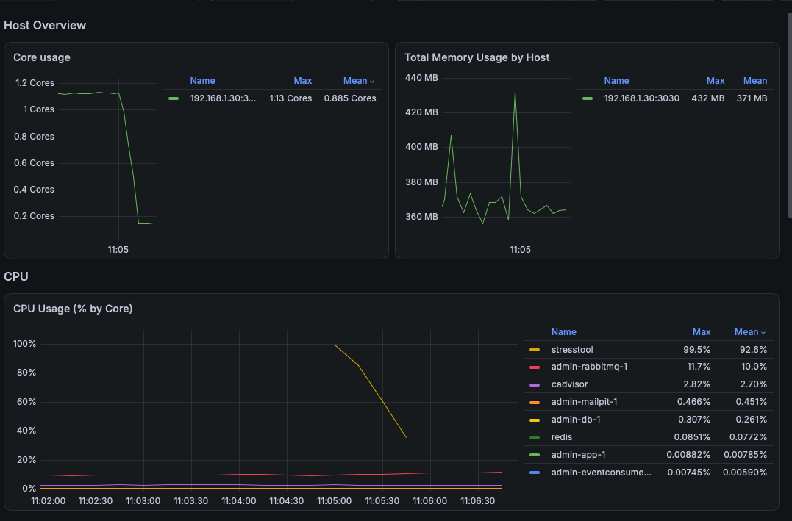
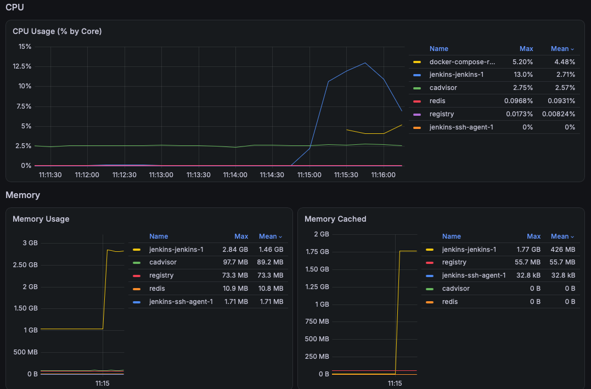
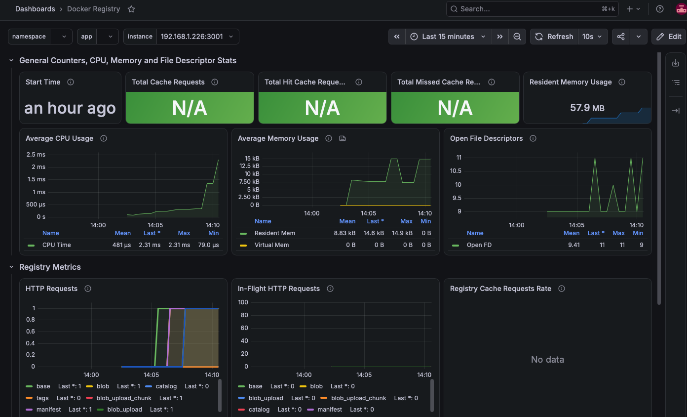

# Monitoring

## Introduction

Monitoring gives us visibility into the health of our servers and services. A popular technology stack used for monitoring includes Prometheus, Grafana, and Node Exporter.

## Using Docker Compose to start Prometheus/Grafana

On jenkins-server and deployment-server, download the latest node exporter from https://github.com/prometheus/node_exporter and run it.  By default, metrics are published at http://localhost:9100/metrics.

```sh
./node_exporter &
```

Note that if port 9100 is blocked by the firewall, then Prometheus will not be able to scrape the metrics. RedHat Linux uses firewalld by default. To configure the firewall with firewalld, run:

```sh
firewall-cmd --add-port 9100/tcp --zone=public --permanent
firewall-cmd --reload
```

See https://www.redhat.com/en/blog/firewalld-rules-and-scenarios for more information.

Ubuntu uses ufw by default. To configure ufw:

```sh
sudo ufw allow 9100
```

See https://ubuntu.com/server/docs/how-to/security/firewalls/ for more information.

The included Docker Compose file can be used to start Prometheus and Grafana on the KVM host. The volume-mounted prometheus.yml file is pre-configured to monitor the deployment server.

```sh
docker compose up -d
```

## Using Grafana

Point your browser to http://<ip.of.kvm.host>:4444. and login as admin/admin. 

To use dashboards for the deployment server, you need to first add a datasource for Prometheus. To add dashboards, go to Dashboards | Manage | Import and import dashboards. Some popular dashboards are:

- https://grafana.com/grafana/dashboards/10180 (to see one host's details at a time)
- https://grafana.com/grafana/dashboards/1860 (A dashboard to see a host's details)
- https://grafana.com/grafana/dashboards/11074 (to see a list of machines)

One of the surprising things that i discovered was the memory usage on the Jenkins server.



## Adjust KVM memory

This prompted me to give more memory for the Jenkins KVM.

```sh
sudo virsh shutdown jenkins-server
sudo virsh setmaxmem jenkins-server 8G --config
sudo virsh setmem jenkins-server 8G --config
sudo virsh start jenkins-server
```

After 3 builds, memory usage remains well within maximum values.


## Using cAdvisor

cAdvisor exposes container metrics. See https://prometheus.io/docs/guides/cadvisor/.

First open ports. On RedHat:
 
```sh
firewall-cmd --add-port 3030/tcp --zone=public --permanent
firewall-cmd --reload
```

On ubuntu:

```sh
sudo ufw allow 3030
```

Next, copy the docker-compose file to each server.

```ah
scp docker-compose.yaml admin@192.168.1.226:cAdvisor-docker-compose.yaml
scp docker-compose.yaml admin@192.168.1.30:cAdvisor-docker-compose.yam
```

Run the docker-compose file on each server. Run it and see that the services are running and healthy:

```sh
admin@jenkins-server:~$ docker compose -f cAdvisor-docker-compose.yaml ps
NAME       IMAGE                             COMMAND                  SERVICE    CREATED          STATUS                    PORTS
cadvisor   gcr.io/cadvisor/cadvisor:latest   "/usr/bin/cadvisor -…"   cadvisor   38 seconds ago   Up 38 seconds (healthy)   0.0.0.0:3030->8080/tcp, [::]:3030->8080/tcp
redis      redis:latest                      "docker-entrypoint.s…"   redis      39 seconds ago   Up 38 seconds             0.0.0.0:6379->6379/tcp, [::]:6379->6379/tcp
```

You can view contianer metrics at port 3030.

```sh
curl http://192.168.1.226:3030/containers/
curl http://192.168.1.30:3030/containers/
```

If prometheus.yml needs to be reloaded, you can reload all the services.

```sh
docker compose restart
```

To view cAdvisor metrics in Grafana, I like to use the cAdvisor exporter dashboard, which is dashboard 21743. Initially the line graphs were fairly flat. To generate stress, I built a simple tool called `stresstool`, which is based on an issue I found when developing the event-consumer. Below is a screenshot with the stresstool container running on deployment-server.



Once I stopped the container the CPU usage went down.



The cAdvisor metrics for the jenkins-server showed that CPU and memory usage for the Jenkins container were well within the limits, even during a build.



Be aware that cAdvisor needs access to the root filesystem of the host filesystem. The docker-compose file mounts */* as read-only. It's strongly advised not to change this, and to only run cAdvisor on VMs, not the host system.

## Monitoring docker registry

Docker registry (also known as distribution) publishes metrics out of the box. Inside the latest docker image, I found the following configuration:

```sh
]$ docker exec -ti registry sh
/ #
/ # cat /etc/distribution/config.yml 
version: 0.1
log:
  level: debug
  fields:
    service: registry
    environment: development
storage:
    delete:
      enabled: true
    cache:
        blobdescriptor: inmemory
    filesystem:
        rootdirectory: /var/lib/registry
    tag:
      concurrencylimit: 5
http:
    addr: :5000
    debug:
        addr: :5001
        prometheus:
            enabled: true
            path: /metrics
health:
  storagedriver:
    enabled: true
    interval: 10s
    threshold: 3
```

This means that all we have to do is change our original command from:

```sh
docker run -d -p 3000:5000 --name registry registry:3
```

to:

```sh
docker run -d \
    -p 3000:5000 \
    -p 3001:5001 \
    -v registry:/var/lib/registry \
    --name registry \
    registry:3.1.2
```

Below are some metrics:

```sh
$ curl http://localhost:3001/metrics
# HELP go_gc_duration_seconds A summary of the wall-time pause (stop-the-world) duration in garbage collection cycles.
# TYPE go_gc_duration_seconds summary
go_gc_duration_seconds{quantile="0"} 3.7932e-05
go_gc_duration_seconds{quantile="0.25"} 3.7932e-05
go_gc_duration_seconds{quantile="0.5"} 0.00022268
go_gc_duration_seconds{quantile="0.75"} 0.00022268
go_gc_duration_seconds{quantile="1"} 0.00022268
go_gc_duration_seconds_sum 0.000260612
go_gc_duration_seconds_count 2
```

Below is a screenshot of the registry dashboard (dashboard 9621) after pushing a few docker images to the registry.

