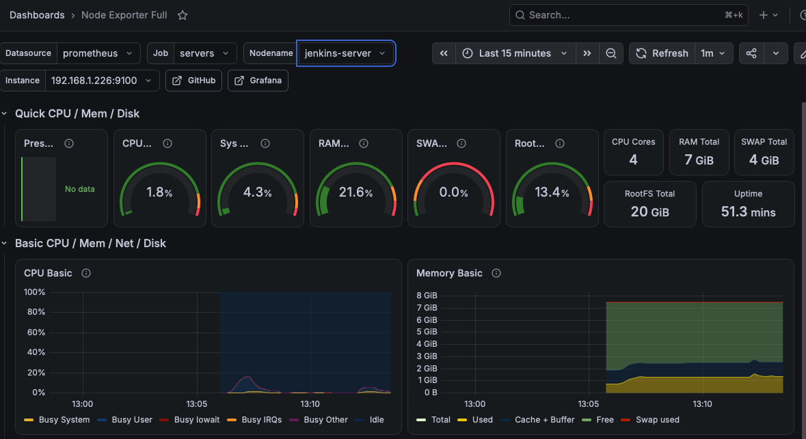

# Monitoring

## Introduction

Monitoring gives us visibility into the health of our servers and services. A popular technology stack used for monitoring includes Prometheus, Grafana, and Node Exporter.

## Using Docker Compose to start Prometheus/Grafana

On the deployment server, download and instlal the latest node exporter from https://github.com/prometheus/node_exporter.  By default, metrics are published at http://localhost:9100/metrics.

```sh
./node_exporter &
```

The included Docker Compose file can be used to start Prometheus and Grafana on the KVM host. The volume-mounted prometheus.yml file is pre-configured to monitor the deployment server.

```sh
docker compose up -d
```

## Using Grafana

Point your browser to http://<ip.of.kvm.host>:4444. and login as admin/admin. 

To use dashboards for the deployment server, you need to first add a datasource for Prometheus. To add dashboards, go to Dashboards | Manage | Import and import dashboards. Some popular dashboards are:

- https://grafana.com/grafana/dashboards/10180 (to see one host's details at a time)
- https://grafana.com/grafana/dashboards/1860 (A dashboard to see a host's details)
- https://grafana.com/grafana/dashboards/11074 (to see a list of machines)

One of the surprising things that i discovered was the memory usage on the Jenkins server.


## Adjust KVM memory

This prompted me to give more memory for the Jenkins KVM.

```sh
sudo virsh shutdown jenkins-server
sudo virsh setmaxmem jenkins-server 8G --config
sudo virsh setmem jenkins-server 8G --config
sudo virsh start jenkins-server
 ```

 After 3 builds, memory usage remains well within maximum values.

 